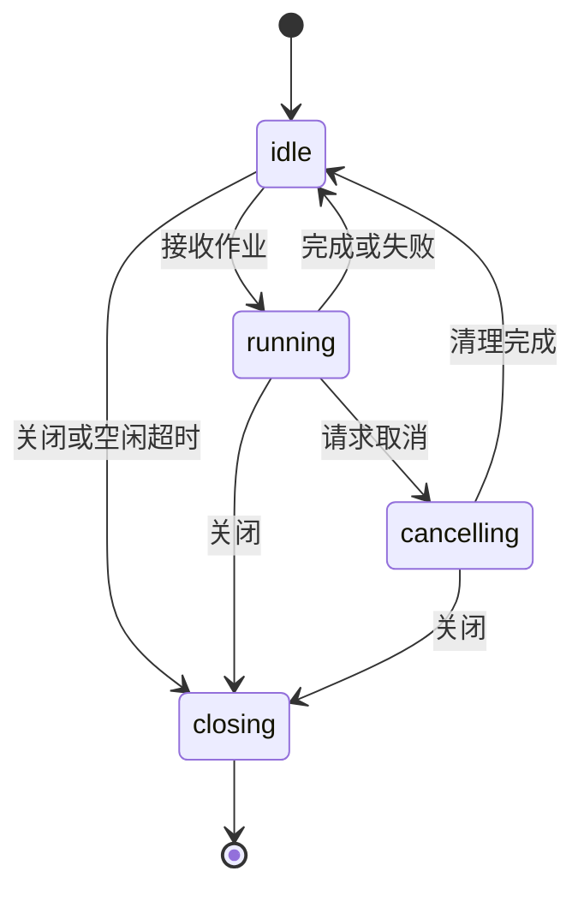

# 持久会话：观察、执行与取消

持久会话是一个保留 Zuse Runtime 的本地进程。客户端提交脚本后即可退出，
后续客户端仍能使用已注册的函数、运行时设备与锚点，并查询或取消正在执行的作业。
一次提交是一个作业；接收成功与执行完成分别有回执，不依赖一直打开的 shell 标准输入。

## 启动并提交源码

为同一工作流选择一个会话名：
名称使用 1–40 个 ASCII 字母、数字、下划线或连字符。

```sh
zuse session start board --idle-timeout-ms 900000
zuse session status board
zuse session script board - <<'ZUSE'
fn inspect() { timer.status() }
inspect()
ZUSE
```

`start` 等到服务可以响应后才返回，回执包含 `socket`、`pid` 与当前状态。
在 ssmcp 等会回收任务进程树的宿主中，把 `session serve` 作为长期任务启动；
`start` 的后台子进程仍受宿主生命周期管理，客户端无法保证它在任务结束后继续存活。
`script` 接受完整 Zuse 源码，返回 `job_id` 后异步执行。用实际 ID 替换下面的 `JOB_ID`：

```sh
zuse session result board JOB_ID
```

等待结果为 `completed`、`failed` 或 `cancelled`，再提交下一段脚本。
例如第二次提交 `inspect(); functions()` 可以复用第一段定义的函数。
源码仍由 Zuse 准备并执行，坐标计算、循环、递归和桌面输入无需外部程序展开。

## 命令

| 命令 | 作用 |
| --- | --- |
| `session start NAME [--idle-timeout-ms N]` | 启动后台服务，并等待就绪。 |
| `session serve NAME [--idle-timeout-ms N]` | 在前台运行服务，适合进程管理器。 |
| `session status NAME` | 读取状态、状态修订号及作业标识。 |
| `session script NAME -` | 从 stdin 提交完整脚本。 |
| `session observe NAME -` | 提交强制只读的观察脚本。 |
| `session result NAME [JOB_ID]` | 查询指定或最近作业的回执。 |
| `session cancel NAME` | 请求取消当前作业；继续查结果确认清理完成。 |
| `session close NAME` | 取消并清理当前工作，释放运行时，关闭会话。 |

`script` 支持 `--read-only`、`--dry-run`、`--max-steps` 和 `--max-wait-ms`；
`observe` 支持后三项，并始终开启只读检查。只有空闲会话接受新作业，运行中提交返回 `busy`。
`status`、`result` 和取消控制保持可用。`observe` 也会占用一次作业，不在输入执行中并行读取 Runtime。

```sh
zuse session observe board - <<'ZUSE'
timer.status()
functions()
ZUSE
```

观察脚本经过整段只读预检；包含输入操作时，在前面的操作执行前拒绝。
`--dry-run` 仅准备和检查，不提交新函数或产生应用输入。失败预检不会替换会话中已有定义。
当前持久通道执行 flat Runtime 程序及展开后的数值程序；scoped mouse 程序可以预检，尚不在该通道实际执行。

## 状态与清理



取消是协作式停止：正在等待或分派输入的执行器检查取消令牌，随后报告结果并释放应清理的资源。
`cancelling` 仅表示取消已请求；正在执行的原生派发可能尚未返回，需要继续查看作业结果。
取消不撤销应用已经处理的动作。下一个作业使用新的取消状态，可以继续执行。
`close` 的成功回执表示清理已完成；服务只删除自己创建且身份仍匹配的 socket。
如果 10 秒内尚未清理完，会返回 `closing` 和 `resources_released=false`；此时不能宣称会话已关闭。

默认空闲超时是 900000 ms，即 15 分钟。运行和取消期间不消耗空闲时间；
完成后重新开始计时，有效控制请求会刷新空闲时间。保持一个无数据连接或发送未完成帧不会持续续期。
空闲超时会释放整个会话，不会把函数、锚点或设备自动恢复到另一个进程。

## 外部控制器

服务使用版本化 JSON-lines Unix socket 协议，普通程序或模型驱动的控制器都可以连接。
读取 `start` 返回的确切 socket 路径，并遵循[会话协议](session-protocol.md)。
典型循环是观察、等待观察结果、决定下一段 Zuse 源码、提交、等待执行结果，再观察。
模型调用和游戏策略由控制器负责；会话服务负责有界执行、状态与回执，不内置 JEV 或模型 RPC。

仓库附带只依赖 Python 标准库的[客户端示例](../examples/session_client.py)。
它从 stdin 读取一次源码，提交一次，并通过同一连接查询到作业终态：

```sh
zuse_socket=$(zuse session status board |
  python3 -c 'import json,sys; print(json.load(sys.stdin)["socket"])')
printf '%s\n' 'timer.status()' |
  python3 examples/session_client.py --socket "$zuse_socket" --observe
```

去掉 `--observe` 即提交普通作业。`--max-steps` 和 `--max-wait-ms` 设置 Zuse 预算；
`--timeout-ms` 限制客户端等待，超时后作业可继续执行，客户端不会重发源码。
Ctrl+C 会尝试按已知修订号取消同一 socket 实例中的作业，随后仍需查询结果确认清理。

为需要重试的动作指定稳定的 `--request-id ID`；为防止基于旧状态提交，使用
`--expect-revision N`，其中 `N` 来自最近的状态或结果回执。重试必须保留相同请求内容。
服务只保留有界去重记录，长期恢复时应先查询状态及作业结果，不把重新发送当作永久去重保证。

## 本地边界

当前服务使用 Unix domain socket。`start` 返回实际位置；`ZUSE_SESSION_DIR` 可指定运行目录，
该目录必须属于当前用户且权限为 `0700`，不能是符号链接。目录访问权就是本地控制边界，协议不提供远程身份认证。
未指定目录时，优先使用 `$XDG_RUNTIME_DIR/zuse-sessions`，否则使用系统临时目录下的 `zuse-sessions-UID`。
socket 的完整路径最多 100 字节；路径过长时选用更短的绝对运行目录。
socket 权限为 `0600`。最多同时连接 16 个客户端；连接闲置 5 秒会断开，但不会因此销毁仍有效的会话，控制器可以重连。

单次源码最多 256 KiB，单帧最多 2 MiB；每个结果最多保留 512 KiB，最多保留 32 条作业结果。
请求去重缓存最多 64 条、总请求与响应数据最多 8 MiB。完整字段、错误码和重试规则见协议文档。
结果正文超限会返回截断元数据并标记作业失败；这不代表之前的应用动作没有发生。
输入回执仍需结合应用状态判断是否达成目标；`accepted` 只表示作业已接收。

相关验证见 [sessions.rs](../tests/sessions.rs)，使用无桌面输入的 Runtime 作业、真实 Unix socket 和独立 CLI 进程。
